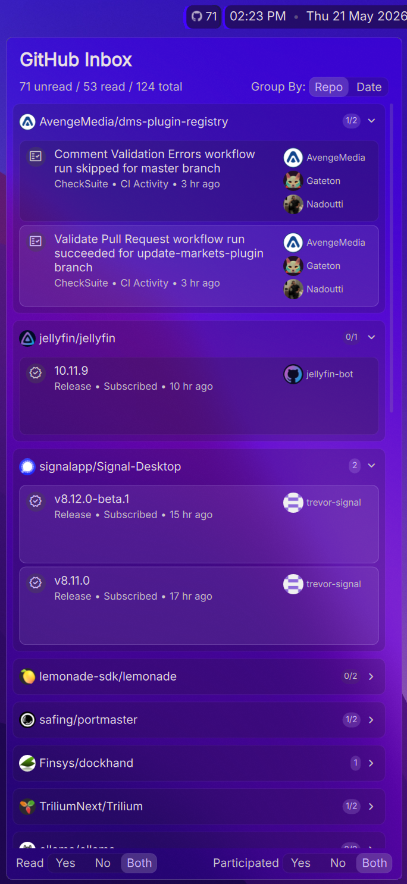
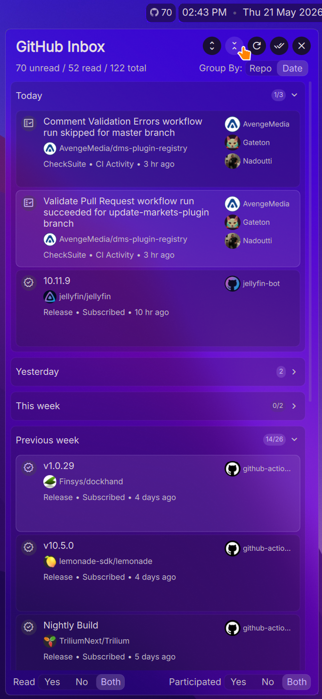
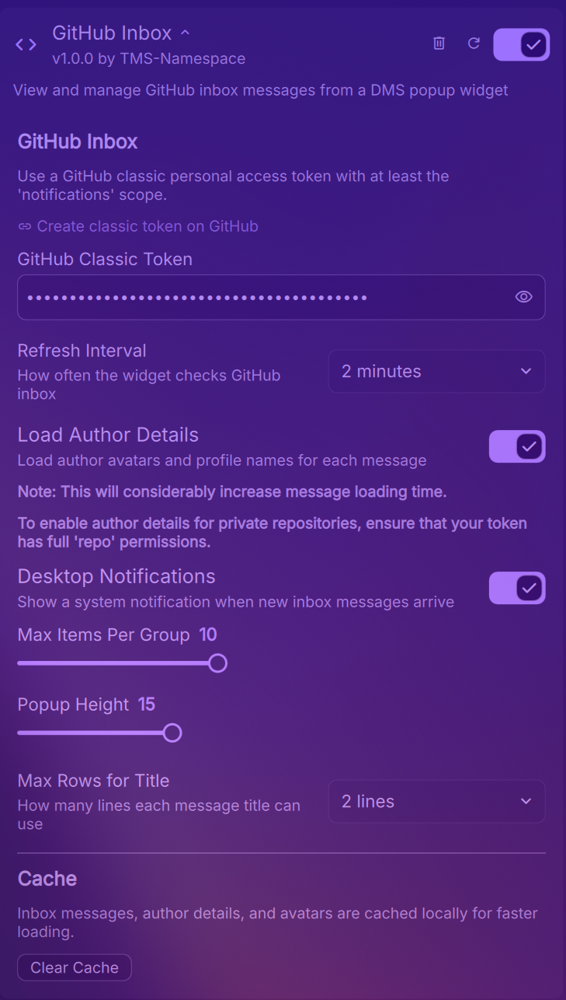

# GitHub Inbox Plugin for Dux Shell

A [Dux Shell (DMS)](https://github.com/duxlabs-dev/dux-shell) widget plugin that shows your `GitHub` notifications (or the so called `Inbox`) in a popup and lets you mark them as read or done.

<div align="center">

| Group by repo | Group by date |
|:---:|:---:|
|  |  |

</div>

## Features

- `DankBar` widget with unread count of Github Inbox messages.
- Popup inbox grouped by repository or date with expandable sections.
- Open a thread source, repository page, or author's page directly in your browser.
- Mark a single thread, a group of threads, or all threads as read/done.
- Configurable refresh interval.
- Configurable popup item limit and title line count.
- Show a `DMS` notification for new incoming threads.
- Filter options:
  - Show read, unread, or all threads.
  - Show threads you participated in, did not participate in, or all threads.

<div align="center">

| Settings |
|:---:|
|  |

</div>

## Authentication

This plugin uses a **GitHub classic personal access token**, which can be created on <https://github.com/settings/tokens>.

*Recommended token scope*:

- `notifications`
- To show full details for threads from private repositories, also enable the full `repo` permission for this token.

## Requirements

- Dux Shell (DMS) >= 2.0.0.
- `curl` for authenticated GitHub API requests, `jq` for response processing, `secret-tool` (libsecret) for secure token storage, and `file` for cached-avatar MIME checks.
- `bash`, `find`, and coreutils commands (`nice`, `cp`, `mkdir`, `cat`, `rm`, `env`, `sleep`) in `$PATH` for background processes and cache management.
- The built-in `dms notify` and `dms dl` commands provide desktop notifications and avatar downloads. No `libnotify` dependency is needed.
- Unlocked Freedesktop Secret Service keyring to store the token.
- Internet access to GitHub's API and avatar hosts.

## Limitations

- Currently, Github notifications API does not return a separate `Done` flag. The plugin caches done status of messages locally, and infers that a currently visible thread was marked done on GitHub when it disappears from the returned by API results. This is a best-effort workaround.
- Some GitHub inbox messages, including organization security alerts, and `Dependabots`, will be missed, since `GitHub` does not provide a well generalizable way to fetch them.

## Version History

- v2.0.0 :
  - New: Added setting button in top bar.
  - Improvement: Migration to `Dux API v2`.
  - Improvement: Structural refactoring for easier future maintenance.
  - Improvement: Better test coverage.
  - Improvement: Basic validation of the authentication token.
  - Improvement: Some cosmetic changes.
  - Fix: Bug with how grouping by date works.
  - Fix: API statistics were showing wrong info.
- v1.0.1 :
  - Fixed `DMS` comments [published here](https://github.com/AvengeMedia/dms-plugin-registry/issues/554#issuecomment-5899485656).
  - Fixed some inbox messages was missing.
  - Ensuring all command lines uses `bash` to avoid issues when user has a different default shell.
  - Token passed via `stdin`.
  - Dynamic `Github` page logic, with improved `done` management logic.
  - Added retry in specific cases.
- v1.0.0 :
  - Initial version.

## Install

### Method 1

In DMS:

1. Open `Settings -> Plugins`
2. Click `Scan for Plugins`
3. Enable `GitHub Inbox`
4. Add widget to DankBar

### Method 2

Or clone repo, and run (this will add `Symlink` to plugin folder):

```bash
chmod +x support/setup-symlink.sh
support/setup-symlink.sh
```

## Privacy & Security

- Contacts `api.github.com` for inbox and author data, `avatars.githubusercontent.com` for user avatars, and `github.com` for app avatars and the GitHub icon.
- Opening a thread, repository, author, or token-settings link launches the system browser.
- Writes cache files under `${XDG_CACHE_HOME:-~/.cache}/dms-github-inbox-plugin`, falling back to `/tmp/dms-github-inbox-plugin` if the normal cache path cannot be resolved. The cache includes notifications, author metadata, downloaded avatars, and backups of unreadable or incompatible cache files.
- Stores the GitHub token through `Freedesktop Secret Service` via `secret-tool`. Authenticated requests send the token to `curl` over stdin.
- Does not require elevated privileges.

## Contributions

Feel free to submit your PR, try to follow [Code Requirements](docs/code_requirements.md).

The plugin has `isDevMode` in `src/QML/Tools/Constants.qml`, which enables logging for debugging when true.

## Disclaimers

- The developer has no affiliation with data provider.
- This plugin was vibe-coded under my supervision as a software engineer.
